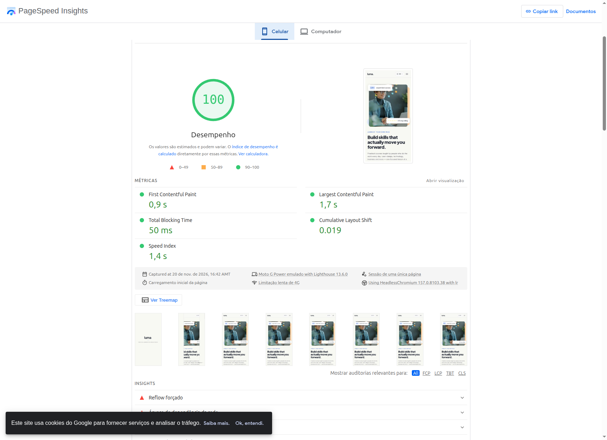
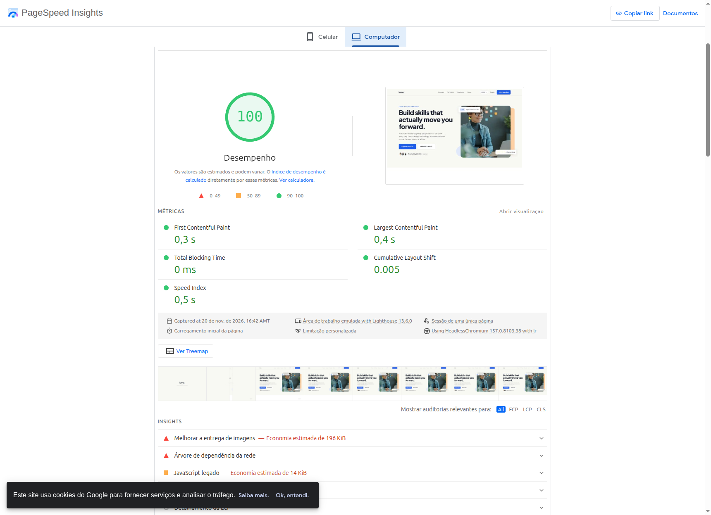

# Luma — Buzzvel Front-End Engineer Coding Challenge (Nov 2026)

Responsive, internationalized (`EN` / `PT` / `ES` / `FR` / `DE`) single-page landing site for **Luma** built from the supplied Figma design using **Next.js App Router**, **TypeScript**, and **Tailwind CSS v4**, statically exported and deployed on **Cloudflare Pages** with a Cloudflare Pages Function (`POST /api/contact`) powered by **Resend**.

- **Live Preview (EN)**: [https://buzzvel-fe-test-2026.pages.dev](https://buzzvel-fe-test-2026.pages.dev)
- **Live Preview (PT)**: [https://buzzvel-fe-test-2026.pages.dev/pt](https://buzzvel-fe-test-2026.pages.dev/pt)
- **Live Preview (ES)**: [https://buzzvel-fe-test-2026.pages.dev/es](https://buzzvel-fe-test-2026.pages.dev/es)
- **Live Preview (FR)**: [https://buzzvel-fe-test-2026.pages.dev/fr](https://buzzvel-fe-test-2026.pages.dev/fr)
- **Live Preview (DE)**: [https://buzzvel-fe-test-2026.pages.dev/de](https://buzzvel-fe-test-2026.pages.dev/de)
- **PageSpeed Insights Report**: [Run live check](https://pagespeed.web.dev/analysis?url=https%3A%2F%2Fbuzzvel-fe-test-2026.pages.dev%2F)

## Getting Started

### Prerequisites

- Node.js 20+ (developed with Node 26)
- `pnpm` 10+ (or `npm` / `yarn`)

### Install, Run, Build & Test

```bash
# Install dependencies
pnpm install

# Start development server (http://localhost:3000)
pnpm dev

# Lint
pnpm lint

# Run unit & component tests (Vitest + Testing Library)
pnpm test

# Create static production export in ./out (ready for Cloudflare Pages)
pnpm build
```

### Deploying to Cloudflare Pages

```bash
pnpm build
npx wrangler pages deploy out --project-name=buzzvel-fe-test-2026
```

## Performance & Core Web Vitals (Google PageSpeed Insights)

Measured on the live Cloudflare Pages production URL (`https://buzzvel-fe-test-2026.pages.dev/`) across **both Mobile and Desktop**:

| Metric | Mobile | Desktop |
| --- | :---: | :---: |
| **Performance** | **100** | **100** |
| **Accessibility** | **100** | **100** |
| **Best Practices** | **100** | **100** |
| **SEO** | **100** | **100** |
| **First Contentful Paint (FCP)** | `0.9 s` | `0.3 s` |
| **Largest Contentful Paint (LCP)** | `1.7 s` | `0.4 s` |
| **Speed Index (SI)** | `1.4 s` | `0.5 s` |
| **Total Blocking Time (TBT)** | `50 ms` | `0 ms` |
| **Cumulative Layout Shift (CLS)** | `0.019` | `0.005` |

### Mobile — 100 / 100 / 100 / 100



### Desktop — 100 / 100 / 100 / 100



### Key Performance Optimizations

- **Zero render-blocking CSS**: Enabled `experimental.inlineCss: true` in `next.config.ts` so the ~10 KiB compressed Tailwind v4 stylesheet is inlined into the static HTML export, removing the render-blocking CSS round-trip.
- **Pre-hydration BrandIntro reveal**: The center-split curtain transition is driven directly by the inline bootstrap script in `DocumentShell` + CSS selectors (`html[data-intro="opening"]`) and synchronized with `BrandIntro` on hydration, so Mobile FCP/LCP/Speed Index never wait on the React JS bundle.
- **100% GPU-composited animations**: Curtain seam shadows/borders are rendered on `::after` pseudo-elements transitioning only `opacity`, paired with `transform`-only curtain movement (zero non-composited layout/paint animations).
- **Responsive LCP hero image delivery**: Serves a dedicated mobile WebP (`public/images/hero-learner-sm.webp`, `560×684`, `18 KiB`) via `<picture>` and media-matched `<link rel="preload" as="image" fetchPriority="high">`, while setting `preload: false` on Google Fonts (`display: "swap"` with size-adjusted fallbacks) so the Hero LCP image gets top HTTP/2 bandwidth priority.

## Architecture & Implementation Highlights

- **Static-first i18n (`EN` / `PT` / `ES` / `FR` / `DE`) with zero client hydration flicker**:
  - Uses Next.js App Router route groups (`src/app/(default)` for `/` in English, and `src/app/[locale]` with `generateStaticParams` for `/en`, `/pt`, `/es`, `/fr`, and `/de`) sharing a single `DocumentShell` and `LandingPage`.
  - Typed dictionaries in `src/i18n/dictionaries/{en,pt,es,fr,de}.ts` cover every heading, body copy, CTA, image `alt` attribute, ARIA label, SEO/OpenGraph tag, and contact form validation error.
  - Emits accurate `<html lang="...">`, localized `<title>` and OpenGraph `locale` / `alternateLocale`, and `hreflang` alternates (`en`, `pt`, `es`, `fr`, `de`, `x-default`).
  - `LanguageSwitcher` renders a compact, keyboard-accessible dropdown with `<Link>` elements (`/`, `/pt`, `/es`, `/fr`, `/de`), `aria-current="page"`, and `hrefLang`.
- **Server Components by default**: Only `BrandIntro`, `LanguageSwitcher`, `MobileMenu`, `ContactForm`, `CountUp`, and the lightweight `Reveal` scroll wrapper use `"use client"`, keeping the client JavaScript footprint minimal.
- **Center-split Brand Intro & choreographed scroll/count-up animations (`src/components/layout/BrandIntro.tsx`, `src/components/ui/Reveal.tsx`, `src/components/ui/CountUp.tsx`)**:
  - Minimal editorial brand splash screen on initial load (`luma.` wordmark, expanding horizontal rule, localized tagline, and a center-split curtain opening transition synchronized with the Hero entrance). Skipped automatically on `#hash` anchor navigation or when `prefers-reduced-motion: reduce` is active.
  - Zero-dependency, GPU-composited (`opacity` + `transform`) reveal system with distinct, cohesive variants per element family: `fade-up` for editorial headings/copy, `card` (lift + scale) for category, metric, contact info, and form cards, `badge` (spring pop) for floating badges, step icons, metadata pills, and avatar stacks, `slide-left`/`slide-right` for two-column flows, `line-x` for drawing the horizontal step connector, and `zoom` for featured imagery and staggered mosaic columns.
  - Interactive `AvatarStack` where hovering any learner face scales the avatar, zooms the portrait, and smoothly pushes adjacent avatars apart.
  - Locale-aware `CountUp` animates quantitative metrics (`24,000+` / `24.000` / `24 000`, `120+`, `4.9` / `4,9`, `24K+`, `92%`) from `0` using `tabular-nums`, preserving SSR text and `sr-only` final values for screen readers.
- **Transactional contact email delivery via Resend (`functions/api/contact.ts`, `src/lib/contact-email.ts`)**:
  - Submitting the Contact form sends a real transactional confirmation email to the visitor in their active locale (`EN`, `PT`, `ES`, `FR`, or `DE`) via a Cloudflare Pages Function (`POST /api/contact`) integrated with **Resend** (`Luma <contato@diogolimadev.com.br>`), plus a copy of the inquiry to the team.
  - Gracefully falls back in local static preview environments when `RESEND_API_KEY` is not configured.
- **Design tokens in CSS (`src/app/globals.css`)**: Colors, typography font families (`Plus Jakarta Sans` and `Inter` via `next/font/google` with `display: swap`), and shadow tokens are extracted directly from the Figma file and mapped via Tailwind CSS v4 `@theme inline`.
- **Reusable UI primitives**:
  - `src/components/ui/` provides reusable `Button` (polymorphic link/button with variants), `Container`, `Eyebrow`, `SectionHeading`, `AvatarStack`, `Reveal`, `CountUp`, and inline SVG `Icons`.
  - `src/components/layout/` contains `DocumentShell`, `BrandIntro`, the sticky `Header` (with `LanguageSwitcher` and `MobileMenu`), and `Footer`.
  - `src/components/sections/` implements all 8 sections (`Hero`, `Categories`, `FeaturedCourse`, `HowItWorks`, `Testimonial`, `People`, `Contact` + `ContactForm`, and `FinalCTA`).
- **Static export & image optimization**: Configured with `output: "export"` and `experimental.inlineCss: true` for Cloudflare Pages. All photographs in `public/images/` were pre-optimized and right-sized to crisp Retina WebP assets (including a dedicated `18 KiB` mobile Hero variant), keeping `hero-learner.jpg` for OpenGraph crawler compatibility.
- **Accessibility & reduced motion**:
  - Semantic landmarks (`<header>`, `<nav>`, `<main>`, `<section>`, `<figure>`, `<footer>`), localized skip-to-content link, single `<h1>`, descriptive `alt` text (and `aria-hidden` on decorative shapes/icons).
  - Keyboard-friendly focus rings (`focus-visible:ring-2`) across all interactive controls.
  - Global `@media (prefers-reduced-motion: reduce)` rule disables smooth scrolling, intro splash, scroll reveals, and transitions.

## Key Design Decisions & Clarifications

Because the Figma file does not define prototype links, tablet artboards, or an open mobile menu state, the following intentional choices were made:

1. **Inferred interactions**:
   - **Navigation & CTAs**: Header links, footer links, and section CTAs smoothly scroll to their corresponding page sections (`#courses`, `#featured-course`, `#how-it-works`, `#testimonial`, `#people`, `#contact`).
   - **Mobile menu**: Designed to match the header surface (`#F9F8F3` with `#DBDFEB` borders). Includes `aria-expanded` / `aria-controls`, body scroll locking, automatic close on `Escape`, backdrop click, link navigation, or resizing to desktop, plus focus management (moves focus to the first link on open and returns focus to the trigger on `Escape`).
   - **Contact form**: Client-side validation (`src/lib/validation.ts`) supporting localized validation messages for full name (2+ chars), valid email format, and question (10+ chars). Errors are announced via `role="alert"` and linked with `aria-invalid` / `aria-describedby`. Valid submission posts to `/api/contact` (sending a localized confirmation email via Resend), renders a `role="status"` confirmation banner, and resets the form.
   - **Hover, focus & scroll states**: Added subtle elevation/border hover feedback, arrow slide transitions, interactive avatar stack hover scale/push, star rating glint wave, and smooth GPU-composited scroll reveals between sections.
2. **Tablet layout (`768px–1023px`)**:
   - Header switches to the full horizontal nav bar at `md` (`768px`) with non-wrapping links, language toggle, and CTAs.
   - Hero keeps the visual above the copy until `lg` (`1024px`) so both columns have comfortable breathing room.
   - Category cards use a 2-column grid at `sm`/`md` and 4 columns at `lg`.
   - How It Works steps and Testimonial stats switch to 3 columns at `md` and above.
3. **Design inconsistencies resolved**:
   - **Step numbering**: The desktop Figma frame labels all three steps as `"Step 01"`, while the mobile frame labels them `"Step 01"`, `"Step 02"`, `"Step 03"`. Numbered sequentially (`01`, `02`, `03`) across all viewports and locales.
   - **Contact form email field**: The mobile Figma frame uses Portuguese placeholder text (`"E-mail"` / `"seuemail@exemplo.com"`) while the desktop frame uses English (`"Email"` / `"youremail@example.com"`). Standardized to match each active locale (`/`, `/pt`, `/es`, `/fr`, `/de`).
   - **Contrast adjustments**: Slightly darkened secondary muted text on cream (`#6D7384` → `#666C7C`) and used `#FFFFFF` for subtle text on the primary blue background (`#3157F6`) to exceed the 4.5:1 WCAG AA contrast threshold without altering the visual feel.
   - **People section copy**: Kept the Figma copy verbatim on the English route (`/`) for strict design fidelity, and provided natural localized community copy on `/pt`, `/es`, `/fr`, and `/de`.
   - **FinalCTA decorations**: Positioned from Figma desktop coordinates inside an `overflow-hidden` container and hidden on smaller screens to match the mobile frame.

## Verification & Quality Checks

| Check | Result |
| --- | --- |
| `pnpm lint` | Passed (0 warnings, 0 errors) |
| `pnpm test` | 9 suites / 26 tests passed (`validation`, `i18n`, `contact-email`, `BrandIntro`, `LanguageSwitcher`, `Reveal`, `CountUp`, `ContactForm` EN+PT, `MobileMenu`) |
| `pnpm build` | Passed cleanly (`out/` static export with `/`, `/en`, `/pt`, `/es`, `/fr`, `/de`, `404.html`) |
| Responsive overflow (`360px`–`1440px`) | 0 horizontal overflow across 360, 402, 768, 1024, 1280, 1440px |
| `axe-core` (WCAG 2.1 AA + best practices) | 0 violations (desktop, mobile, open mobile menu, form validation state) |
| Google PageSpeed Insights (Desktop) | Performance **100** · Accessibility **100** · Best Practices **100** · SEO **100** (FCP `0.3s`, LCP `0.4s`, SI `0.5s`, TBT `0ms`, CLS `0.005`) |
| Google PageSpeed Insights (Mobile) | Performance **100** · Accessibility **100** · Best Practices **100** · SEO **100** (FCP `0.9s`, LCP `1.7s`, SI `1.4s`, TBT `50ms`, CLS `0.019`) |
| Live Cloudflare Pages smoke test | HTTP 200 on all locales, 20/20 images loaded, `POST /api/contact` delivers localized Resend confirmation emails |

## Known Gaps

- Navigation links (`Log in`, `View course`, `Terms`, `Privacy`, etc.) are mapped to on-page section anchors since this challenge covers a single landing page with no multi-page routing.

## Approximate Time Spent

~4 hours total (design inspection & asset extraction, project setup, responsive section implementation, static-first 5-language i18n, BrandIntro + scroll/count-up animations, Resend transactional email integration on Cloudflare Pages Functions, WebP & Core Web Vitals optimization to 100/100 Mobile & Desktop, accessibility & visual verification, automated tests, and documentation).

## AI Tools Used & Verification

AI coding assistants (Claude and Antigravity/Gemini inside T3 Code) were used to inspect the Figma node tree, extract exact design tokens and SVGs, scaffold components and i18n dictionaries, optimize Core Web Vitals, and write automated verification scripts.

All generated output was verified against the design and quality bar through Playwright viewport, scroll-reveal, and screenshot checks, `axe-core` WCAG 2.1 AA scans, live Google PageSpeed Insights audits (Mobile & Desktop 100/100/100/100), keyboard navigation tests, Vitest + Testing Library unit/component tests, ESLint, a clean Next.js static export build, and live smoke testing on Cloudflare Pages.
